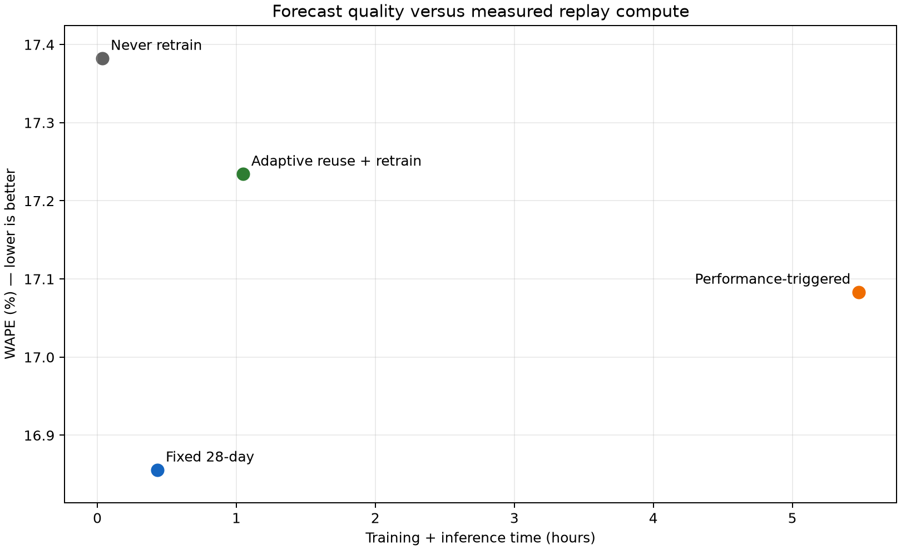

# NYC taxi demand forecasting

The selected model and maintenance rules are tested in a locked replay of 2020–2025, including the 2020 demand disruption. Scheduled retraining every 28 days achieved 16.86% WAPE; error-triggered retraining reached 17.08% with more training jobs. The result favors a simple schedule for this replay.

