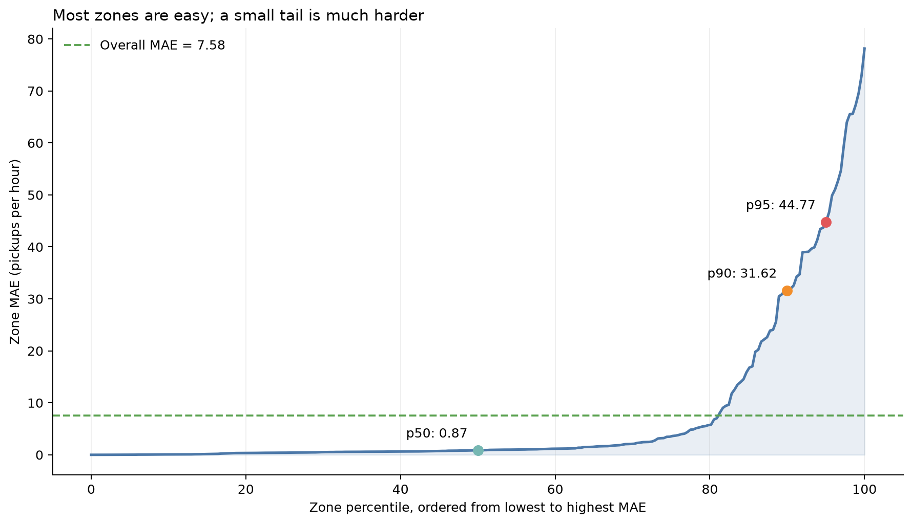

# NYC taxi demand forecasting

The data and baseline stages showed that demand is uneven across zones and changes over time. This stage compares training windows and demand regimes on common future targets, while checking input quality before evaluation. These tests guide which model comparisons are worth carrying forward.

