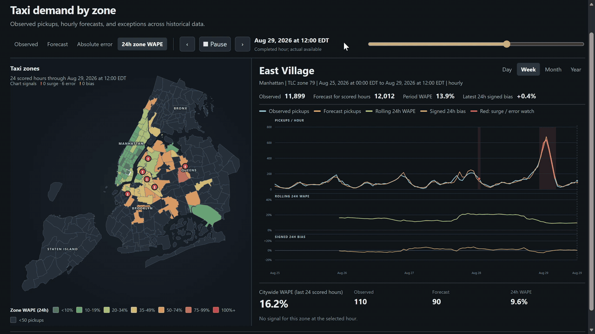

# NYC taxi demand forecasting

*The dashboard plays back historical data; it does not show current taxi
traffic.*

## The question

How often should a demand-forecasting model be updated when a city changes? I
used NYC Yellow Taxi trips to forecast pickups one hour ahead in each of 263
taxi zones, then compared simple and reactive ways to maintain the model. The
aim was to see whether the extra work of reacting to poor forecasts actually
improved them.

## What the data showed

Trips were aggregated into hourly demand for every zone. An hour with no pickups
is a valid zero; an hour missing from the source is a data problem and is
rejected. In a January 2019 sample, **48.2% of zone-hours had no pickups**,
while the busiest **25 zones accounted for 71% of trips**. Demand also repeated
strongly from one hour and one week to the next. Those observations shaped the
lag features and made a single citywide score insufficient.

I tracked overall WAPE (absolute error divided by observed demand), error across
zones and demand levels, prediction bias, and whether every expected zone
received a forecast.

*Early baseline, January 2019: median zone error was 0.87 pickups per hour, but
the 95th-percentile zone error was 44.77. This is not the final model.*

## Choosing a model

Using 2017 to mid-2019 data, I compared four forecasters on the same 15 future
28-day windows:

| Forecaster | Mean WAPE |
|---|---:|
| Daily/weekly seasonal blend | 18.07% |
| Ridge regression | 16.74% |
| Poisson regression | 58.12% |
| LightGBM with a Poisson objective | **12.44%** |

LightGBM performed best. Removing recent-demand features raised its WAPE to
15.03%, so I kept them. Longer and seasonal training histories did not show a
reliable gain over a rolling year; the final model uses the preceding 365 days.

## Deciding when to update it

I set the maintenance rules using the second half of 2019, then left them
unchanged while replaying 2020–2025. All four policies predicted the same 13.83
million zone-hours, including the sharp demand drop in March 2020.

| Update policy | WAPE | Training jobs |
|---|---:|---:|
| Retrain every 28 days | **16.86%** | 79 |
| Retrain after an error trigger | 17.08% | 238 |
| Reuse an older model, then retrain | 17.23% | 131 |
| Keep the original model | 17.38% | 1 |

The 28-day schedule had the lowest error, but improved WAPE by only about **3%
relative** to never retraining. The reactive policies used more training or
model selection without improving on the schedule. I chose the 28-day schedule
for accuracy; keeping the original model remains a useful low-maintenance
reference.

## The working system

The local pipeline turns trips into hourly demand, builds features from
information available at forecast time, records each prediction with its model
version, and scores it after the actual demand arrives. It monitors forecast
error separately from pipeline failures. Alerts call for review; they do not
silently retrain or replace the model. Repeated runs reuse verified predictions
and scores.

In a 168-hour replay, all **44,184 zone-hours** were scored. WAPE reached
**23.03%**, which raised a forecast-quality alert even though the pipeline
itself completed normally.

The dashboard map can show observed demand, forecasts, absolute error, or recent
WAPE. Selecting a zone reveals demand and forecast history, bias, and
unusual-demand or error markers over a day, week, month, or year. The year view
covers all 263 zones; the advancing view replays historical hours.

The alert thresholds were set from 2017–2019 behavior and became too sensitive
after 2020; continued use would require a reviewed recalibration.
